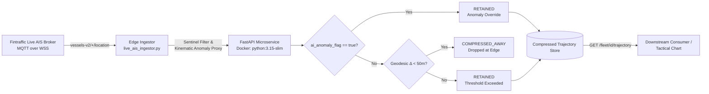
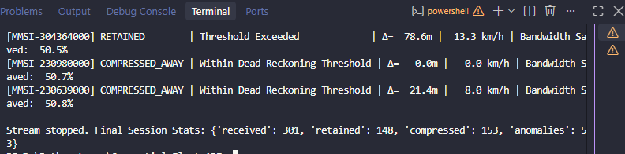

# FleetEdge: Anomaly-Aware Spatiotemporal Compression Microservice

A containerized FastAPI microservice that applies **anomaly-aware geodesic Dead Reckoning (inspired by BWC-DR-A)** to high-frequency mobility telemetry streams.

## Problem Statement
Moving IoT assets (maritime vessels, rail fleets, and connected vehicles) broadcast high-frequency GNSS/AIS updates every 2–10 seconds. Relaying raw streams over constrained wireless links (satellite, maritime VDES/HF, or cellular dead zones) saturates uplink bandwidth and inflates storage costs. Conversely, naive spatial downsampling risks discarding the exact low-displacement, high-risk maneuvers (e.g., sudden turns, drifting, or emergency braking) required for operational monitoring.

This service simulates a resource-constrained **edge node** that drops redundant trajectory points within a configurable geodesic threshold while guaranteeing 100% retention of points flagged by an upstream anomaly detector.

---

## System Architecture



### Compression Rules (`app/main.py`)
Each incoming payload is evaluated against the vehicle's last retained anchor coordinate using geodesic distance (`geopy.distance.geodesic`):
1. **Initial Registration:** First coordinate for a new `vehicle_id` is retained to establish the baseline anchor.
2. **Anomaly Override (Priority Rule):** If `ai_anomaly_flag` is `true`, the payload bypasses spatial compression and is force-retained regardless of displacement.
3. **Dead Reckoning Drop:** Under normal operation (`ai_anomaly_flag == false`), points within `DR_DEVIATION_THRESHOLD_METERS = 50.0` are discarded (`COMPRESSED_AWAY`).
4. **Trajectory Preservation:** Normal points moving `>= 50.0` meters are retained and become the new anchor coordinate.

---

## Empirical Validation (Live Baltic Sea AIS Stream)

Tested end-to-end by streaming live public AIS broadcasts from **Fintraffic Digitraffic Marine** (`wss://meri.digitraffic.fi:443/mqtt`) into the running Docker container across 15 concurrently tracked vessels.

| Metric | Live Session Result |
| :--- | :--- |
| Total AIS Messages Ingested | **301** |
| Points Retained at Edge | **148** (49.2%) |
| Redundant Points Dropped (`COMPRESSED_AWAY`) | **153** (**50.8% Bandwidth Reduction**) |
| Flagged Anomaly Points Preserved | **53 / 53 (100% Retention)** |

### Observed Edge Behaviors
* **Continuous Anomaly Sequence (`MMSI-230639000`):** Over 141 seconds (`22:16:30`–`22:18:51 UTC`) near the Åland Islands (`60.11°N, 20.31°E`), this vessel decelerated from `5.56 km/h` to `2.22 km/h` while executing a tight ~220° harbor turn. The override rule preserved all **42 consecutive turning coordinates** despite small inter-point distances. Once the vessel stabilized onto a straight heading at `8.0 km/h`, compression automatically resumed (`COMPRESSED_AWAY | Δ = 21.4m`).
* **Stationary Fleet Suppression (`MMSI-230980000`):** Moored vessel pings (`Δ = 0.0m`, `0.0 km/h`) were dropped automatically without consuming trajectory storage.



### Live Stream Data Veracity Note
During live ingestion testing, several vessels without onboard Rate-of-Turn (ROT) gyroscopes broadcast `rot = ±128`—the ITU-R M.1371 sentinel value indicating *"turn data unavailable."* Without filtering, a naive `abs(rot) > 15` threshold falsely classifies every sensor-less vessel as anomalous. The ingestor explicitly guards against sentinel readings (`abs(rot_deg_min) < 127.0`) before evaluating kinematic anomaly rules.

---

## Design Trade-offs & Scope

This repository is intentionally scoped as a lightweight, reproducible edge prototype. The table below documents the deliberate simplifications made versus a full distributed deployment:

| Subsystem | Prototype Implementation | Production-Scale Architecture |
| :--- | :--- | :--- |
| **State Storage** | In-memory Python dictionary (`Dict`) for zero-dependency sub-millisecond reads | Near-edge **InfluxDB** (time-series logging) + **PostGIS / MobilityDB** (spatial indexing) |
| **Compression Policy** | Fixed geodesic Dead Reckoning threshold (`50m`) with boolean anomaly override | Time-windowed priority queue enforcing a hard uplink byte budget (full BWC-DR-A) |
| **Anomaly Detection** | Deterministic kinematic proxy (`ROT` & `SOG` thresholds) in ingestor | Online federated Gaussian Mixture Models (e.g., `M³fed`) updated across edge nodes |
| **Execution Engine** | Python + FastAPI on `python:3.12-slim` for rapid API prototyping | Compiled C/C++ spatiotemporal operators (e.g., **MEOS** embedded in **NebulaStream**) |

---

## Quick Start

### 1. Build and Run the Containerized Edge Node
```bash
docker build -t vesseledge-api .
docker run -p 8000:8000 vesseledge-api
```
Interactive OpenAPI / Swagger documentation is available at `http://localhost:8000/docs`.

### 2. Stream Live Maritime AIS Telemetry
In a separate terminal (host environment):
```bash
pip install paho-mqtt requests
python live_ais_ingestor.py
```

### 3. Manual API Smoke Test
```bash
curl -X POST http://localhost:8000/telemetry \
  -H "Content-Type: application/json" \
  -d '{
    "vehicle_id": "SNCB-TRAIN-01",
    "timestamp": "2026-11-20T08:00:00Z",
    "latitude": 50.8351,
    "longitude": 4.3350,
    "speed_kmh": 0.0,
    "ai_anomaly_flag": false
  }'
```

### 4. Run Unit Tests
```bash
pip install pytest httpx
pytest -v
```

---

## API Reference

| Method | Endpoint | Description |
| :--- | :--- | :--- |
| `POST` | `/telemetry` | Evaluates a single GNSS/AIS point against BWC-DR-A rules and returns the retention verdict (`RETAINED` / `COMPRESSED_AWAY`) and displacement in meters. |
| `GET` | `/fleet/{vehicle_id}/trajectory` | Returns the compressed trajectory, total retained point count, and preserved anomaly count for a tracked asset. |

---

## References
1. Gräupl, T., Reisenbauer, A., Graser, A., Dragaschnig, M., Dejaegere, G., & Sakr, M. (2025). *Federated Learning and Trajectory Compression for Enhanced AIS Coverage*. IEEE MARIS / arXiv:2512.03584.
2. Duarte, M. M. G., Nugroho, D. P. A., Tod, G., Bevernage, E., Moelans, P., Saerens, E., Zimányi, E., Sakr, M., & Zeuch, S. (2025). *Mobility Data Stream Processing Beyond the Cloud*. ACM SIGSPATIAL '25.
3. Wu, S., Torp, K., Sakr, M., & Zimányi, E. (2026). *Analysis of Unconstrained Trajectories, the Case of AIS*. In *Data Engineering for Data Science*, Springer.
